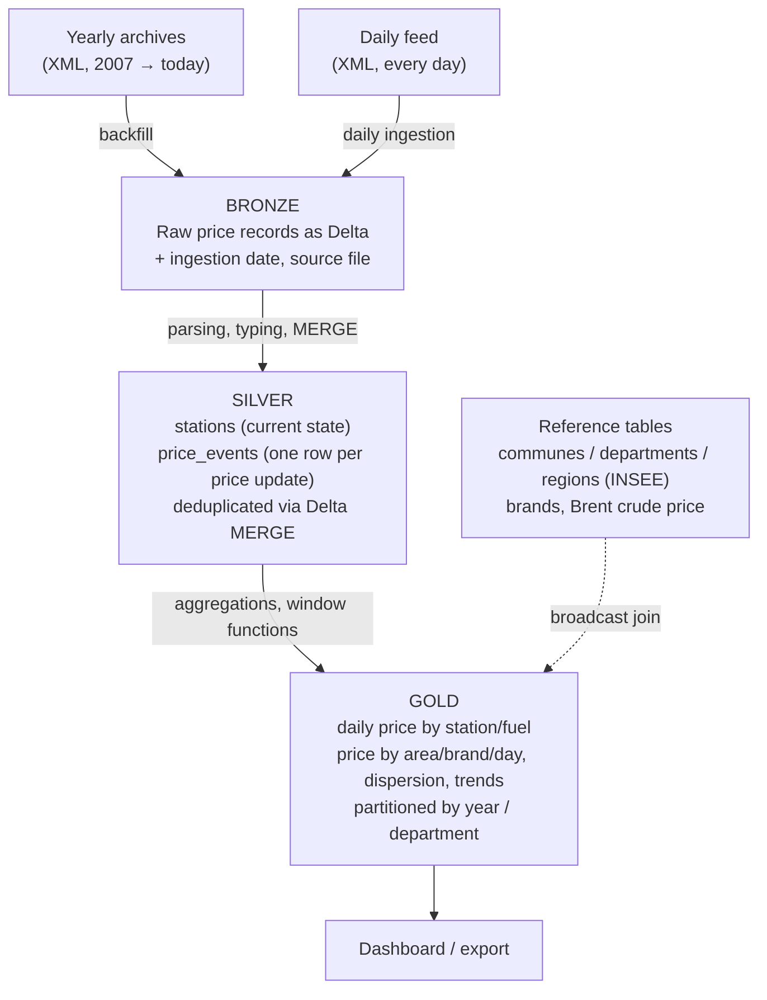

# fuel-lakehouse

An incremental, idempotent data pipeline that analyzes fuel prices at every gas station in France, built with PySpark and Delta Lake on a Medallion architecture. Daily refresh, 19 years of history, production-grade practices.

## Goal

The French Ministry of Economy publishes the price of every fuel sold at every gas station in France, about 10,000 stations, as open data on [prix-carburants.gouv.fr](https://www.prix-carburants.gouv.fr). Stations are legally required to declare each price change, so the feed is a near real-time picture of a market watched daily by oil majors, supermarket chains and consumers.

This project turns that raw feed into analysis-ready tables that answer business questions:

- average price by fuel, region, department and brand, day by day,
- price dispersion inside a city: how much the same litre varies between nearby stations,
- pricing strategy by station type: supermarkets versus oil majors versus independents, highway versus urban,
- pass-through speed: how fast pump prices follow crude oil up versus down (the "rockets and feathers" effect),
- shortages and station closures over time, by region,
- anomaly detection: stale prices, outliers, stations that stop reporting.

The technical objective, which drives every design choice, is to run **like a production pipeline**: every day the new price updates are merged into the lakehouse without duplicates, and every step can be re-run safely with no side effects.

## Data source

Three feeds, all free, no account, no API key, published by the Ministry of Economy (DGCCRF):

| Feed | URL | Refresh | Content |
|------|-----|---------|---------|
| Instant | `https://donnees.roulez-eco.fr/opendata/instantane` | Every 10 minutes | Current price of each fuel at each station |
| Daily | `https://donnees.roulez-eco.fr/opendata/jour` | Daily (previous day) | Current prices, with the timestamp of the last update |
| Yearly archive | `https://donnees.roulez-eco.fr/opendata/annee/{YYYY}` | Once per year, 2007 to today | Every price update of the year |

Each feed is a zip containing one XML file (`ISO-8859-1` encoded). Measured on October 26, 2026:

| File | Stations | Price records | Size (XML) |
|------|----------|---------------|------------|
| Daily | 9,947 | 30,275 | 14 MB |
| Yearly 2025 | 14,420 | 5,297,800 | 386 MB |

The full history since 2007 is roughly 100 million price records, enough to make partitioning, skew and join strategy matter.

**Schema (one `pdv` element per station):**

- station: `id`, `latitude`, `longitude` (both multiplied by 100,000), `cp` (postal code), `pop` (R = road, A = highway), `adresse`, `ville`
- `horaires`: opening hours per weekday, 24/7 automat flag
- `services`: list of services (car wash, shop, ATM, ...)
- `prix`: one per fuel, with `nom` (Gazole, SP95, SP98, E10, E85, GPLc), `id`, `maj` (update timestamp), `valeur` (price per litre)
- `rupture`: fuel shortages, with start, end and type (temporary or definitive)
- `fermeture`: station closures, with start, end and type

There is no brand in the feed. The brand is inferred from the station address and name through a reference table built in the Silver layer, or joined from an external open dataset (OpenStreetMap).

## Architecture

The pipeline follows the Medallion pattern: three Delta Lake layers, each one a cleaner and more aggregated view of the previous one.



| Layer | Content | Key operations |
|-------|---------|----------------|
| Bronze | XML parsed into flat rows, one per price record, stamped with ingestion date and source file. Never deleted. | XML read, explicit schema, Delta append, partition by year |
| Silver | `stations`: one row per station with its current attributes. `price_events`: one row per (station, fuel, update timestamp), typed, cleaned. | Coordinate scaling, type casting, outlier filtering, dedup key, Delta MERGE (upsert) |
| Gold | `daily_prices`: price per station, fuel and day (forward-filled). `area_prices`: aggregates by department, region, brand, fuel and day. `price_dispersion`, `pass_through`. | Group by, window functions (lag, rolling averages, forward fill, rank), broadcast join, partitioning |

Data quality checks run between each layer (nulls, duplicates, expected schema, row counts, price ranges) and block the run on failure.

**Incremental logic.** The daily feed is a snapshot of current prices, each with the timestamp of its last update. The pipeline merges each (station, fuel, timestamp) into `price_events`: already-known updates are ignored, new ones are inserted. Re-running the same day twice produces the same table. The yearly archives follow the same path for the one-time backfill.

## Why this project

Two reasons.

1. **Consolidate Spark skills on real data volume.** About 100 million price records, a genuine data skew (Île-de-France concentrates stations and price changes), nested XML to flatten, and daily time series that call for window functions.
2. **A credible, production-grade portfolio project.** Modular code, externalized configuration, tests, data quality checks, logging, and a clear path to orchestration and cloud deployment.

## Production principles

What separates this from a notebook exercise:

- **Incremental and idempotent.** New price updates are merged, never appended blindly. Re-running a step produces the same result.
- **Modular, testable code.** One module per layer, pure transformation functions, pytest coverage.
- **Externalized configuration.** No hard-coded paths. Storage, feed URLs and Spark settings live in `config/config.yaml`, so the same code runs locally or on object storage in the cloud.
- **Quality gates.** Checks between layers, with explicit failures.
- **Observability.** Structured logging, no `print`.
- **Cloud-agnostic by design.** The business logic does not change when moving from local disk to S3, ADLS or GCS.

## Spark skills demonstrated

- DataFrame API, nested XML ingestion and flattening, Delta Lake writes
- Cleaning, typing, null and outlier management
- Window functions: daily price per station with forward fill, day-over-day change, rolling averages, rank of stations within a city
- Joins and broadcast joins with small reference tables (communes / departments, brands, crude oil price)
- Optimization: partitioning, repartition / coalesce, reading execution plans, predicate and partition pushdown
- Data skew diagnosis in the Spark UI (median vs max task time) and salting where relevant
- Delta Lake: MERGE, time travel, partitioning, schema evolution

## Roadmap

| Phase | Scope | Status |
|-------|-------|--------|
| 1. Local pipeline | SparkSession with Delta, Bronze (daily feed, then yearly backfill), Silver, Gold, quality checks, simple orchestration in `main.py` | In progress |
| 2. Orchestration | Airflow DAG running daily: download, Bronze, Silver, Gold, checks, with retries and alerts | Planned |
| 3. Cloud | Object storage (S3 / ADLS / GCS) and managed Spark execution (e.g. Databricks). Provider to be chosen at this phase | Planned |
| 4. Production deployment | Deployed Airflow, scheduling, secrets management, monitoring, CI | Planned |
| Later | Streaming layer on the 10-minute instant feed with Structured Streaming | Idea |

## Project structure

```
fuel-lakehouse/
├── README.md
├── PROJECT.md                 # project memory: context, decisions, roadmap
├── requirements.txt
├── config/
│   └── config.yaml            # paths, feed URLs and parameters, nothing hard-coded
├── src/
│   ├── download.py            # fetch and unzip the feeds
│   ├── ingestion.py           # XML -> Bronze
│   ├── transform_silver.py    # Bronze -> Silver (stations, price_events, MERGE)
│   ├── transform_gold.py      # Silver -> Gold (aggregates, window functions)
│   ├── quality_checks.py      # checks between layers
│   └── utils.py               # Delta SparkSession, config loading, logging
├── data/                      # local storage (raw/bronze/silver/gold), git-ignored
├── tests/
│   └── test_transforms.py
└── main.py                    # orchestration: runs the layers in order
```

## Getting started

Setup and run instructions will be added as the layers are built (Phase 1).

## Data license

The fuel price data is published under the French [Licence Ouverte / Open Licence 2.0](https://www.etalab.gouv.fr/licence-ouverte-open-licence/). Reuse is free with attribution to the Ministry of Economy. The data contains no personal information.
