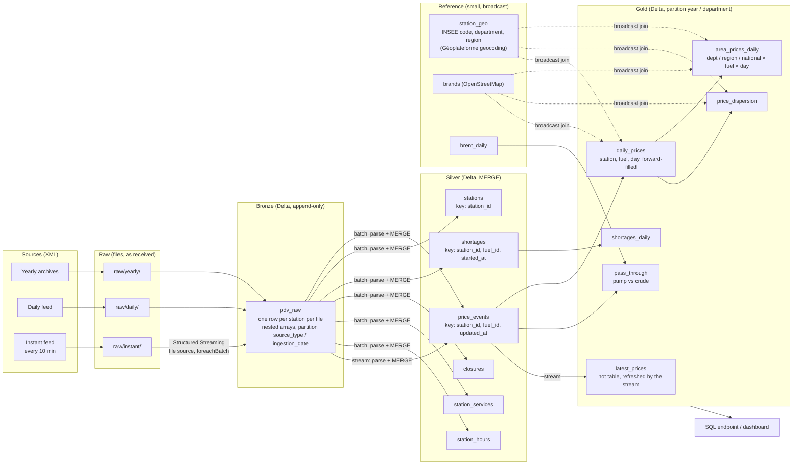

# Architecture

Target architecture of fuel-lakehouse: three sources, one Medallion lakehouse, batch and streaming converging on the same Silver tables.

## Sources

| Source | Cadence | Nature | Role in the pipeline |
|--------|---------|--------|----------------------|
| Yearly archives (2007 → N-1) | Once a year | Event log: every price update | One-time backfill, audit |
| Daily feed | Once a day (J-1) | Snapshot: current price per station and fuel | Daily reconciliation: completeness |
| Instant feed | Every 10 minutes | Snapshot: current price per station and fuel | Low-latency path: freshness |

All three share the same XML schema, so one parsing function serves the three paths.

## Flow

## Layers

**Raw.** Files exactly as downloaded, named by source and timestamp. Never modified. Lets any layer be rebuilt without touching the source.

**Bronze: `pdv_raw`.** One row per station per source file, faithful to the XML: station attributes plus nested arrays for prices, shortages, closures, services and hours. Added columns: `source_type` (yearly / daily / instant), `source_file`, `snapshot_ts`, `ingested_at`. Append-only, partitioned by `source_type` and `ingestion_date`. This is the system of record.

**Silver.** Typed, cleaned, deduplicated by MERGE.

| Table | Grain | MERGE key | Notes |
|-------|-------|-----------|-------|
| `price_events` | one price update | station_id, fuel_id, updated_at | Fed by all three sources. Columns: price, source_type, ingested_at, flags (outlier). Partition by year. |
| `stations` | one station | station_id | Current attributes, scaled coordinates, first_seen, last_seen. Type 1 now; SCD2 history is a later extension. |
| `shortages` | one shortage | station_id, fuel_id, started_at | ended_at and type updated on MERGE when the feed fills them. |
| `closures` | one closure | station_id, started_at | |
| `station_services` | station × service | station_id, service | Rebuilt from the latest snapshot. |
| `station_hours` | station × weekday | station_id, weekday | opens, closes, closed flag, is_24_7. |

**Reference.** Small tables, broadcast in joins: `station_geo` (address normalized once through the Géoplateforme geocoder: INSEE commune code, department, region), `brands` (OpenStreetMap `amenity=fuel`), `brent_daily` (crude price and EUR/USD).

**Gold.** Business tables at dashboard grain, partitioned by year and department.

| Table | Grain | Content |
|-------|-------|---------|
| `daily_prices` | station × fuel × day | Closing price, average, number of updates, forward-filled on days without update, staleness age |
| `area_prices_daily` | level (dept / region / national) × fuel × day, with road / highway split | median, mean, p10, p90, station count, day-over-day change, 7-day moving average |
| `price_dispersion` | commune or dept × fuel × day | max − min, standard deviation, cheapest station |
| `pass_through` | fuel × day, national | pump price vs Brent in EUR, lags 0 to 14 days, asymmetric response |
| `shortages_daily` | dept × fuel × day | active temporary shortages, share of stations affected |
| `latest_prices` | station × fuel | Current price, refreshed by the streaming path. Serves a live map. |

## Batch path (daily)

1. Download the daily feed to `raw/daily/`.
2. Bronze: parse XML, append to `pdv_raw`.
3. Silver: MERGE into every Silver table.
4. Gold: recompute the affected partitions (current year, touched departments).
5. Quality checks between each layer; any failure stops the run.

Re-running a day is a no-op: same keys, same MERGE, same result.

## Streaming path (every 10 minutes)

The instant feed is a file regenerated every 10 minutes, not a message queue. The streaming path therefore uses Spark Structured Streaming with a **file source** on `raw/instant/`: each new file is a micro-batch. On Databricks this is exactly the Auto Loader pattern.

- A lightweight poller downloads the instant feed to `raw/instant/<timestamp>.xml` every 10 minutes.
- `readStream` on the folder, the same parse function as batch, then `foreachBatch` → MERGE into `price_events` and upsert `latest_prices`.
- Checkpoint directory for exactly-once file tracking; idempotent MERGE makes any replay harmless.
- Trigger: `availableNow` when launched on a schedule (Airflow every 10 minutes, practical on a laptop), or `processingTime="10 minutes"` as an always-on job in the cloud.
- A streaming aggregation with watermark produces `price_ticks`: national median per fuel per 10-minute window, the live pulse of the market.

Batch and stream write the same Silver table with the same key. The daily snapshot reconciles anything the stream missed; the yearly archive backfills and audits. Three sources, one truth.

## Orchestration and serving

- Airflow: a daily DAG (download → bronze → silver → gold → checks), a 10-minute DAG for the instant micro-batch, a manual backfill DAG per year.
- Serving: Gold read through a SQL engine (DuckDB locally, the cloud provider's SQL endpoint later) by a dashboard; `latest_prices` feeds a live map.
